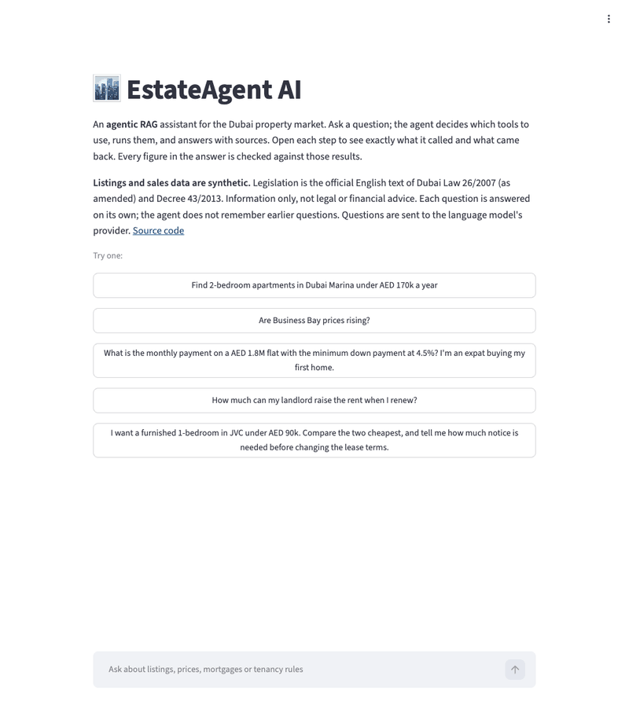
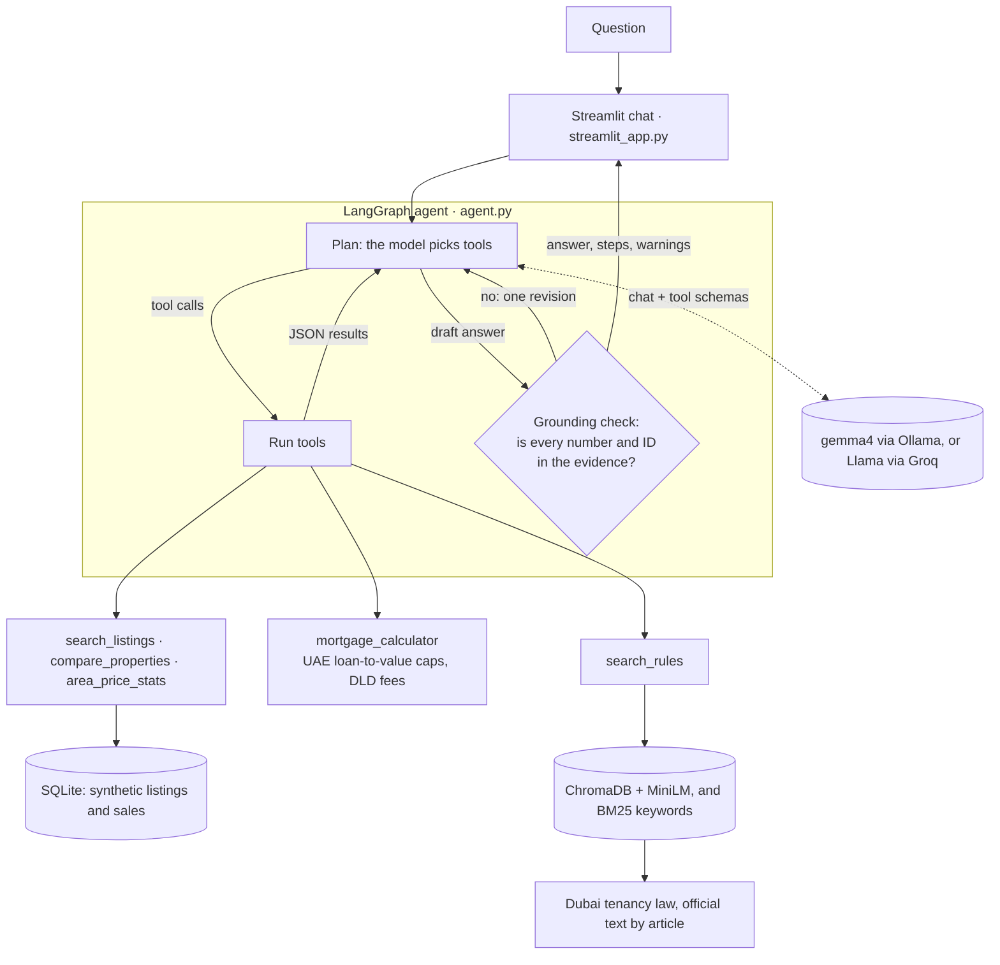

# EstateAgent AI

[](https://github.com/arjun9669/EstateAgent-AI/actions/workflows/ci.yml)

[](LICENSE)

**An agentic RAG assistant for the Dubai property market.** Ask a question in plain
language; a LangGraph agent decides which tools to use (listing search, market
statistics, mortgage maths, official tenancy law), runs them, and answers with
sources. Every number in the answer is checked against what the tools returned.

**[▶ Try the live demo](https://appapppy-hadkfldjgvu3gw24nfdysg.streamlit.app/)**: free
hosting, so the first visit after a quiet period takes a moment to wake up; 10
questions per visitor.



*Recorded from the real app ([`scripts/record_demo.py`](scripts/record_demo.py)): two tool
calls, the grounding check, a cited answer, then one step opened to show the raw tool
result. Listings are synthetic.*

## Highlights

- **Agent, not a chatbot.** The model plans tool calls over several rounds, reads
  tool errors and retries, and is forced to answer when a round limit is hit.
  Every figure comes from deterministic Python tools, never from the model.
- **Hybrid RAG over official law.** Dubai tenancy legislation is split into
  citable articles and searched by meaning (MiniLM embeddings in ChromaDB) plus
  keywords (BM25), added after the evaluation caught a keyword the embeddings missed.
- **Grounding check.** Each number and listing or law ID in a draft answer must
  appear in a tool result or the question ("AED 2.3 million" matches 2,277,500).
  The model gets one chance to fix anything unsupported; the rest is shown as a warning.
- **Measured, not assumed.** Three frozen question sets (64 questions), each change
  checked on a set written before it, every run recorded and re-scored in CI, and
  every failure read by hand, including two bugs found in the scorer itself.
- **Free to run, model-agnostic.** Local or cloud models through Ollama with no key
  in the project, or Groq's free API; hosted on Streamlit Community Cloud. The same
  evaluation compares models (gemma4 31B in the cloud against qwen3 4B on an 8 GB desktop).
- **Tested.** 150+ tests, offline in CI with a scripted model and a stand-in embedder.

## Architecture



The model only plans and writes. The five tools are plain Python with JSON
schemas for tool calling ([`tools/`](src/estate_agent/tools/)); a test keeps the
schemas in sync with the functions. Tool errors go back to the model as messages so it
can correct its arguments, and each result carries a `source` so answers can cite it.

| Tool | Example question | Backed by |
|---|---|---|
| `search_listings` | "2BR in JVC under 90k a year, furnished" | SQLite listings table |
| `compare_properties` | "Compare L0435 and L0503" | Price per sq ft against similar listings |
| `area_price_stats` | "Are Dubai Marina prices rising?" | Median sale prices, this year vs. last, with a warning when sales are few |
| `mortgage_calculator` | "Can I afford AED 1.6M on 12k a month?" | UAE Central Bank loan-to-value caps, DLD fees, 50% debt burden limit, checks stated as sentences |
| `search_rules` | "How much can my landlord raise the rent?" | Hybrid search over Law 26/2007 (as amended) and Decree 43/2013 |

## Evaluation

Three frozen question sets ([v1](eval/cases-v1.json), [v2](eval/cases-v2.json),
[v3](eval/cases-v3.json); v2 and v3 written before the changes they test) score each
answer on tool choice, correctness, citation support and grounding, with
`gemma4:cloud`. Cases passing all four, per run:

| Configuration | v1 (30) | v2, held out (20) | v3, held out (14) | Answers showing field names |
|---|---|---|---|---:|
| Meaning-only law search | **27** (1 run) | — | — | — |
| + hybrid law search, quotation rule | **28, 29, 29, 29** | **19, 18** | — | 2 / 160 |
| + pass on tool warnings | **30, 30** | **19, 18** | **14, 14** | 3 / 128 |
| + plain-English mortgage checks | **30, 30** | **20, 20** | **14, 14** | **0 / 128** |

Scores use scorer 1.2. Tool choice and grounding are full marks in every run. The
sets are small and author-written on synthetic data, so they show which behaviours
are stable, not real-world accuracy. Protocol, every failure and its reading, and
the scorer fixes: [docs/EVALUATION.md](docs/EVALUATION.md).

### Models

Same agent, prompt, tools and 64 questions; only the model changes:

| Model | Runs on | Cases passing all four checks | Median time per question |
|---|---|---:|---:|
| `gemma4:cloud` (31B) | Ollama cloud, free plan | **64 / 64** (two runs) | **1.6 s** |
| `qwen3:4b` | Locally, M1 iMac, 8 GB | **15 / 64** (one run) | **140 s** |

qwen3:4b chose the right tools in 63 of 64 cases and had the right facts in 56, but
wrote its reasoning and the grounding check's feedback into its answers, which broke
citations. Groq's Llama 70B is planned; the account was restricted during testing.
[Details](docs/EVALUATION.md#model-comparison).

## Run it yourself

Requires Python 3.11+.

```bash
git clone https://github.com/arjun9669/EstateAgent-AI.git
cd EstateAgent-AI
python -m venv .venv && source .venv/bin/activate
pip install -e ".[dev]"
pytest      # offline; no model or key needed
```

**Pick a model** (`cp .env.example .env` to change settings; `.env` is git-ignored):

- **Ollama cloud model, the default setup used here:** install
  [Ollama](https://ollama.com/download), run `ollama signin`, and set
  `OLLAMA_MODEL=gemma4:cloud`. Fast on any computer; the free plan includes a monthly
  starter amount of usage. No key in the project.
- **Local model, offline:** `ollama pull qwen3:4b` (about 2.5 GB). Fits an 8 GB Mac,
  but plans less well.
- **Groq:** set `LLM_PROVIDER=groq` and `GROQ_API_KEY` from
  [console.groq.com](https://console.groq.com).

**Then:**

```bash
streamlit run streamlit_app.py                         # chat page, as hosted
python scripts/ask.py "Are Business Bay prices rising?"  # command line
python scripts/run_eval.py --cases eval/cases-v3.json    # record an evaluation run
```

`python app.py` starts the same chat in Gradio. Hosting notes:
[docs/HOSTING.md](docs/HOSTING.md). A [sample run](docs/SAMPLE_RUN.md) shows six
answers end to end.

## Project structure

```
streamlit_app.py    Streamlit chat page (the hosted demo); app.py is the Gradio version
src/estate_agent/
  agent.py          LangGraph agent: plan, call tools, answer, check
  grounding.py      Checks every figure and ID in an answer against the evidence
  tools/            The five tools and their tool-calling schemas
  web.py, ui.py     Streamlit and Gradio interfaces; presentation.py is shared
  config.py         Model settings: Ollama (local or cloud) or Groq
  evaluation.py     Scores recorded answers on the four dimensions
  data.py, areas.py, dld.py   Data loading, Dubai areas, DLD transactions loader
scripts/            ask, run_eval, compare_runs, compare_models, variation, rescore_runs, record_demo,
                    fetch_rules, generate_sample_data, load_dld_transactions
data/sample/        Synthetic listings and transactions (reproducible from a seed)
data/rules/         Dubai tenancy legislation, one section per article
eval/               Frozen question sets, recorded runs, variation and model reports
docs/               EVALUATION, DATA_SOURCES, HOSTING, SAMPLE_RUN
```

## Data

- **Legislation:** Law No. 26 of 2007 (consolidated with Law No. 33 of 2008) and
  Decree No. 43 of 2013, from the official Dubai Legislation Portal.
- **Listings:** synthetic. Area names are real; every listing, price and ID is invented.
- **Sales transactions:** synthetic by default. A loader converts the Dubai Land
  Department open dataset if you download it yourself; it is not redistributed
  because its licence is unspecified.

Sources and known gaps: [docs/DATA_SOURCES.md](docs/DATA_SOURCES.md).

## Built with

Python · LangGraph · LangChain · Ollama (gemma4) · Groq · ChromaDB · MiniLM (ONNX) ·
BM25 · SQLite · Streamlit · Gradio · pytest · GitHub Actions · Streamlit Community Cloud

## Limitations

- Listings and default sales data are synthetic; this is a portfolio project, not a
  property service.
- The legislation is not fully up to date: later changes, such as the Rental Disputes
  Settlement Centre (Decree 26 of 2013), are not consolidated.
- The grounding check verifies numbers and IDs, not meaning; a correct figure can
  still sit in a misleading sentence. The evaluation reads failures by hand for that reason.
- Each question is answered on its own; the agent does not remember earlier questions.

How the project was built, milestone by milestone: [PLAN.md](PLAN.md).

## Disclaimer

For information and learning only, not legal, financial or investment advice.
Mortgage rules change and lenders may be stricter; check with a lender and the
official sources.

## License

[MIT](LICENSE) © Arjun Kumar
